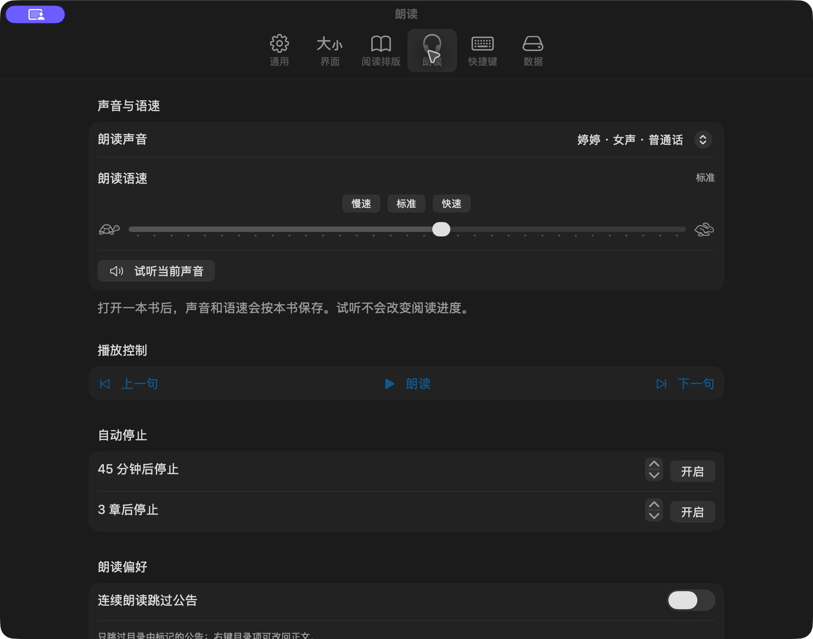

  
  <h1>墨语 · MoYu</h1>
  
<strong>安静读书，随时听书。</strong>

  
为 Mac 打造的原生小说阅读器，把找书、阅读与朗读放在一起。

  

    
    
    
  

  

    <a href="https://github.com/junmo-zy/moyu-mac/releases/latest"><strong>下载最新版</strong></a> ·
    <a href="#快速开始">快速开始</a> ·
    <a href="#常见问题">常见问题</a> ·
    <a href="https://github.com/junmo-zy/moyu-mac/issues">反馈问题</a>
  

 

简洁书架 · 封面直达正文 · 阅读进度一目了然

## 从找书，到读书，再到听书

| 你想做的事 | 墨语可以这样帮你 |
| --- | --- |
| **一次搜索，多处查找** | 同时搜索已启用书源，合并同名同作者结果；失败来源可以单独重试。 |
| **换个来源接着读** | 在可用书源间切换，尝试匹配章节与进度；没有匹配上时可手动选章。 |
| **按自己的习惯阅读** | 滚动、单页、双页及自动布局；鼠标点击左右两侧、触控板横扫或快捷键翻页。 |
| **把界面藏起来** | 上下工具栏靠近边缘时显示，移开后收起；支持全屏、窗口缩放与置顶。 |
| **让正文读给你听** | macOS 系统语音朗读、中文声音名称、男女声分组、语速调整、读音纠正与定时停止。 |
| **没网也能继续** | 导入本地 TXT / EPUB，或提前下载网络章节；本地正文配合已安装语音可离线朗读。 |

## 看得舒服，也用得顺手

### 阅读与排版

- **字体自由选**：系统字体与已安装字体，常见中文字体使用中文名称展示。
- **细调每一页**：正文大小、行距、段距、段首缩进、内容宽度和边距分别调整。
- **六套阅读主题**：纸张、茶绿、雾灰、白纸、暮蓝、夜读，可按环境与个人偏好选择。
- **一本书一种习惯**：支持为当前书籍单独保存排版。
- **快速找回内容**：目录、段落书签、书内搜索和跳转历史集中在阅读侧栏。
- **窗口随手摆放**：缩放、全屏和跨屏移动时保留阅读锚点；窄窗口自动使用单页。

### 朗读与播放

- 声音以“**婷婷 · 女声 · 普通话**”等方式显示，选择更直观。
- 慢速、标准、快速预设，也可以手动微调语速。
- 支持试听、上一句 / 下一句、连续朗读和跟随当前段落。
- 可按分钟或章节设置停止时间，按需跳过公告、网址及站点提示。
- 阅读窗口和菜单栏均可打开迷你播放器，支持全局播放 / 暂停快捷键。

<strong>展开查看：朗读设置与阅读排版</strong>

#### 声音与语速

#### 阅读方式与字体

### 书架与离线管理

- 点击**封面或书名**直接阅读，右键管理书籍资料、封面、分组与下载。
- 支持网格 / 列表、最近阅读、分组、筛选与排序。
- 章节进度排除已识别公告；目录中可以手动修正章节分类。
- 下载后续章节、指定范围或整本书，失败时只重试未成功的章节。
- 退出后保留下载任务，再次打开可继续暂停的任务。
- 在设置中手动导入 / 导出书架备份，或清理可重新获取的章节缓存。

## 快速开始

### 1. 下载并安装

| 项目 | 要求 |
| --- | --- |
| 系统 | macOS 14 或更新版本 |
| 芯片 | Apple Silicon，M 系列 Mac |
| 安装文件 | `MoYu-0.8.1-macOS-arm64.dmg` |
| 当前版本 | 0.8.1（49） |

1. 前往 **[下载页面](https://github.com/junmo-zy/moyu-mac/releases/latest)**，下载 `.dmg` 文件。
2. 打开磁盘映像，将 **墨语** 拖入 **Applications（应用程序）**。
3. 从“应用程序”打开墨语。

当前安装包使用本地 ad-hoc 签名，尚未完成 Developer ID 签名和 Apple 公证，首次打开可能受到 macOS 安全检查限制。当前包不支持 Intel Mac。

### 2. 加入第一本书

**找网络书籍**：进入“搜索” → 输入书名或作者 → 查看多源搜索结果 → 加入书架并打开阅读。

**读本地文件**：点击书架右上角 **＋** → 选择 TXT / EPUB → 导入后点击封面阅读。

### 3. 调好阅读，再开始听书

鼠标移到阅读窗口底部，点击 **Aa** 调整排版，点击主题按钮切换配色，点击耳机按钮进入朗读控制。完整选项也可通过 **设置 → 阅读排版 / 朗读** 调整。

## 书源怎么添加

进入 **书源 → 添加书源**，粘贴书源链接或选择 JSON 文件，预览后勾选导入。

- 支持 HTTPS JSON 直链、GitHub 文件页链接与 `legado://import/bookSource?src=…` 链接。
- 兼容 **阅读 3.0 的常用书源规则**，支持单个书源或批量 JSON。
- 导入后可搜索、筛选、启用、停用、调整优先级和删除书源。
- 同网站的自定义书源可更新规则，并保留已有书籍关联与启停状态。
- 支持检查书源的搜索、目录与正文能力；不兼容的条目会提示原因。

> **兼容范围**：支持常用 CSS、XPath、基础 JSONPath、GET / POST 请求及目录 / 正文分页。暂不执行 JavaScript、Android java 桥或依赖登录 / WebView 的规则；并非所有阅读书源都能直接使用。书源规则可导入，也不代表对应站点一定可访问。

## 常用快捷键

| 操作 | 快捷键 |
| --- | --- |
| 上一页 / 下一页（滚动模式为翻屏） | `←` / `→`、`Page Up` / `Page Down` |
| 下一页 / 上一页 | `空格` / `⇧ 空格` |
| 上一章 / 下一章 | `⌘ ←` / `⌘ →` |
| 打开目录 / 书内搜索 | `⇧ ⌘ T` / `⇧ ⌘ F` |
| 添加段落书签 | `⌘ D` |
| 切换窗口置顶 | `⇧ ⌘ P` |
| 切换全屏 | `⌃ ⌘ F` |
| 退出全屏 | `Esc`（有面板时先关闭面板） |
| 打开设置 | `⌘ ,` |
| 声音设置 | `⌥ ⌘ V` |
| 全局播放 / 暂停 | 默认 `⌥ ⌘ P`，可在设置中更改或关闭 |

⌘ Command · ⇧ Shift · ⌥ Option · ⌃ Control

## 常见问题

<strong>更新会丢失书架和阅读进度吗？</strong>

先退出旧版，再将新版拖入“应用程序”并替换。正常覆盖安装会沿用本机书架、封面、书签与进度。更新前也可以在“设置 → 数据”手动导出书架备份。

“听页”现已更名为“墨语”，仍沿用原有数据位置。

<strong>搜索失败、章节打不开或无法检查更新怎么办？</strong>

先在书源管理中检查对应来源，再尝试单独重试或切换可用来源。站点停用、网络问题或网页规则变更都可能影响可用性。已有缓存和本地书籍仍可阅读。

<strong>离线能阅读和朗读吗？书内搜索覆盖整本书吗？</strong>

本地导入的正文、已缓存或下载的网络章节可以离线阅读。系统已安装相应语音时，这些正文也能离线朗读。

书内搜索覆盖本地书或当前来源已缓存的正文；未下载章节需先下载对应范围，再继续搜索。

<strong>为什么 EPUB 的排版和原书不同？</strong>

当前 EPUB 按阅读顺序提取文字，再使用墨语的阅读排版。暂不保留原书 CSS、正文插图、脚注弹窗或精确的书内目录锚点；固定版式和加密正文不支持。

<strong>书架会自动跨设备同步吗？</strong>

目前书架与进度保存在本机，支持手动导入 / 导出备份，尚未提供自动云同步。书架备份包含本地导入原文，不包含网络缓存和下载队列。

<strong>应该下载哪个文件？Source code 是应用源码吗？</strong>

安装请选择 Release 下的 **`.dmg`** 文件。GitHub 自动生成的 **Source code (zip / tar.gz)** 仅为这个发布仓库的文件快照，不包含墨语应用源码。

本仓库不上传独立的 hash 校验文件；附件旁的 SHA-256 摘要由 GitHub 自动生成。

## 反馈与版本记录

遇到问题可在 **[Issues](https://github.com/junmo-zy/moyu-mac/issues)** 留下应用版本、macOS 版本、芯片型号、复现步骤及相关截图。书源问题请同时注明来源名称和具体失败环节，不必上传个人书架备份。

版本与安装包见 **[Releases](https://github.com/junmo-zy/moyu-mac/releases)**。

---

本仓库用于发布墨语安装包、使用说明与界面展示。应用源代码不公开。 展示图中的书籍与封面用于演示阅读界面，不随安装包分发。

